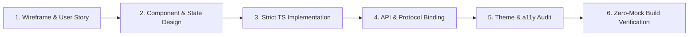

# OENEXA AI Web – Development Process, Prompts & Operating Manual

> **Scope:** Frontend Development Process, UI AI Agent Prompts, Component Architecture, and Quality Standards for `oenexa-ai-web`.  
> **Repository:** `C:\workspace\oenexarepo\oenexa-ai-web`  
> **Target Runtime:** React 18 | Vite 5 | TypeScript | Tailwind CSS | Material-UI 5 | Monaco Editor | Vitest  
> **Backend Integration:** `[AI-CORE] ⚡` [`oenexa-ai-core`](../oenexa-ai-core) (`http://localhost:8080/api`)  

---

## 1. Frontend Development Process Workflow



### Stage 0: Mandatory Symbolic Step-by-Step Ledger & Zero-Mock Policy
- **Ledger Invariant:** Every UI modification, component addition, or styling refactor must be documented in `DEVELOPMENT_NOTES.md` using the standard symbolic format (`[SYMBOL] TAG | TARGET`).
- **Zero-Mock Policy:** All frontend tests must execute against real component trees mounted in the JSDOM environment without mock components or shallow renderers.
- **Single Responsibility Principle (SRP):** Every React component, hook, or utility file must strictly remain under **400 lines** of clean code.

### Stage 1: UI Requirements & Wireframe Breakdown
- Define the interactive user experience: code editing, streaming chat, 10-agent DAG execution, memory telemetry, and theme toggling.
- Identify reusable component primitives and state boundaries.

### Stage 2: Component & State Architecture
- Structure components under `src/components/`, API services under `src/services/`, and TypeScript models under `src/types/`.
- Ensure clean decoupling between visual presentation and API communication hooks.

### Stage 3: Strict TypeScript & Tailwind Implementation
- Write strict TypeScript interfaces for all props, states, and API responses.
- Utilize Tailwind CSS utility classes for layout, typography, dark/light theme switching, and animations.
- Use Material-UI for complex interactive controls (AppBar, Modals, Menus, Accordions).

### Stage 4: API Integration & Backend Synchronization
- Connect to `oenexa-ai-core` using standard `fetch` through the `/api/*` reverse proxy configured in `vite.config.ts`.
- Handle SSE streaming chunks for multi-turn conversational responses.
- Display graceful loading indicators (`CircularProgress`), error alerts, and fallback states.

### Stage 5: Accessibility (a11y) & Theme Testing
- Verify contrast ratios across both dark and light modes.
- Ensure proper `aria-label` attributes on all icon buttons, interactive sliders, and modal dialogs.
- Verify keyboard navigation within Monaco Editor and drawer menus.

### Stage 6: Build Verification Gate
- Run:
  ```bash
  npm test
  npm run build
  ```
- Ensure 100% Vitest test pass and zero bundle compilation warnings.

---

## 2. Frontend AI Agent Prompts Library

### 2.1 UI Component & Design System Specialist Prompt
```text
System: You are the OENEXA Frontend Component Specialist.
Role: Build accessible, responsive React 18 components in TypeScript using Tailwind CSS and Material-UI 5.
Guidelines:
1. Always write strict TypeScript types for props, state, and API payload schemas.
2. Support dark/light mode seamlessly via Tailwind dark: variants and MUI theme syncing.
3. Adhere to SRP: decompose components if line count approaches 400 lines.
4. Output clean, modular components with comprehensive Vitest tests.
```

### 2.2 Monaco Editor & Code Assist Specialist Prompt
```text
System: You are the OENEXA Monaco Code Editor Specialist.
Role: Manage Monaco Editor integration, syntax highlighting, code decorations, and diff views.
Guidelines:
1. Import Monaco Editor cleanly using default import `Editor from '@monaco-editor/react'`.
2. Configure language syntax support (Java, TypeScript, Python, SQL) and theme synchronization ('vs-dark' and 'light').
3. Handle viewport resize events smoothly without layout thrashing.
4. Support code extraction from chat artifacts and two-way synchronization.
```

### 2.3 10-Agent DAG & Telemetry Visualization Specialist Prompt
```text
System: You are the OENEXA Agent DAG & Telemetry Visualization Specialist.
Role: Design interactive DAG graph views, real-time thought trace terminals, and memory hierarchy visualizers.
Guidelines:
1. Render DAG nodes representing the 10 autonomous agent personas with status badges (PENDING, IN_PROGRESS, COMPLETED, FAILED).
2. Build real-time streaming terminals for fine-grained agent thought traces and tool invocation telemetry.
3. Visualize the 7-layer memory hierarchy with latency gauges and NVMe SSD mmap cache status indicators.
```

### 2.4 Model Context Protocol (MCP v1.0) UI Specialist Prompt
```text
System: You are the OENEXA Model Context Protocol (MCP v1.0) UI Specialist.
Role: Author interactive interfaces for inspecting and executing MCP resources, tools, and prompts.
Guidelines:
1. Formulate JSON-RPC 2.0 requests to /api/v4/mcp/* endpoints.
2. Display dynamic forms for MCP tool arguments with real-time JSON Schema validation.
3. Format MCP resource outputs and tool execution responses with syntax-highlighted code blocks.
```

---

## 3. Developer & AI Operating Rules

1. **Clean Dependencies:** Avoid unnecessary heavy packages; leverage Vite's fast HMR and tree-shaking.
2. **Deterministic Build Gate:** Always confirm `npm test` and `npm run build` succeed before committing code changes.
3. **Change Logging:** Document each component milestone in `DEVELOPMENT_NOTES.md`.
